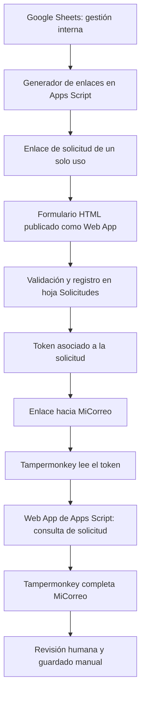

# Franzebi Imports — Automatización de envíos con Correo Argentino

Sistema interno para organizar solicitudes de envío y reducir la carga manual al preparar despachos mediante MiCorreo de Correo Argentino.

> **Estado de la documentación:** basada en los archivos de Google Apps Script y HTML compartidos, junto con una versión anterior del userscript de Tampermonkey. La versión operativa más reciente del userscript no está disponible en este repositorio de trabajo, por lo que algunos detalles de implementación pueden diferir.

## Problema que resuelve

La preparación de un envío implica recopilar datos del destinatario, elegir la modalidad de entrega, registrar la información y volver a cargarla en el portal de Correo Argentino. Este proyecto centraliza la solicitud y automatiza parte de la carga para reducir tareas repetitivas y errores de transcripción.

## Qué hace

- Ofrece un formulario web propio para que el cliente ingrese sus datos de envío.
- Registra las solicitudes en Google Sheets mediante Google Apps Script.
- Mantiene una base de sucursales habilitadas, con información de provincia, código postal, dirección y coordenadas cuando están disponibles.
- Permite generar enlaces de solicitud preconfigurados según la modalidad de entrega y el servicio.
- Utiliza enlaces de un solo uso para vincular la solicitud con el formulario.
- Integra un userscript de Tampermonkey que recupera la solicitud y completa campos de MiCorreo.
- Deja la revisión y la confirmación final del envío a cargo de una persona: **la automatización no debe pulsar el botón final Guardar**.

## Arquitectura



El diagrama representa el flujo conceptual del sistema. La implementación concreta puede variar entre versiones.

## Tecnologías

- Google Apps Script (JavaScript).
- Google Sheets como almacenamiento operativo.
- HTML, CSS y JavaScript para el formulario y la interfaz interna de generación de enlaces.
- Web Apps de Google Apps Script para servir el formulario y exponer operaciones del sistema.
- Tampermonkey para automatizar la interacción con la interfaz web de MiCorreo.
- `GM_xmlhttpRequest` en el userscript para consultar la Web App desde el dominio de Correo Argentino.

## Modalidades contempladas

| Código | Entrega | Servicio |
|---|---|---|
| `SC` | Sucursal | PAQ.AR Clásico |
| `SE` | Sucursal | PAQ.AR Expreso |
| `DC` | Domicilio | PAQ.AR Clásico |
| `DE` | Domicilio | PAQ.AR Expreso |

La modalidad y el servicio se fijan en el enlace generado para que el cliente complete los datos correspondientes sin cambiar la opción contratada desde el formulario.

## Estructura sugerida del repositorio

Los nombres siguientes describen los componentes presentes en la versión compartida. Adaptá los nombres de archivo a los que uses finalmente en Apps Script.

```text
franzebi-correo-argentino/
├── README.md
├── SECURITY.md
├── .gitignore
└── docs/
    ├── arquitectura.md
    ├── datos-y-hojas.md
    ├── instalacion-y-despliegue.md
    ├── flujo-operativo.md
    └── decisiones-y-limitaciones.md
```

Los archivos fuente de Apps Script y Tampermonkey pueden versionarse en una carpeta adicional, siempre que antes se hayan eliminado identificadores privados, tokens y datos reales. Los archivos `.gs` y HTML de un proyecto de Apps Script pueden estar separados en Git aunque se desplieguen juntos en Google Apps Script.

## Configuración y despliegue

La instalación no consiste solamente en ejecutar un script local: requiere una hoja de cálculo, un proyecto de Apps Script, una implementación como Web App y el userscript instalado en el navegador. Consultá [`docs/instalacion-y-despliegue.md`](docs/instalacion-y-despliegue.md).

No publiques en este README la URL real de la Web App, tokens administrativos, IDs privados, datos de clientes ni enlaces de solicitud activos. Usá placeholders en ejemplos.

## Seguridad y privacidad

- No subir nombres, teléfonos, correos, direcciones ni etiquetas de envío reales.
- No publicar tokens administrativos, tokens de solicitudes ni credenciales.
- Tratar los enlaces de solicitud como datos sensibles mientras sigan activos.
- Revisar la configuración de acceso de la Web App y de la hoja de cálculo antes de desplegar.
- Evitar registrar en consola datos personales completos.
- Recordar que el userscript interactúa con una página externa: cambios en el DOM o en las llamadas internas de MiCorreo pueden afectar la automatización.

Más detalles en [`SECURITY.md`](SECURITY.md).

## Limitaciones conocidas

- La automatización depende de la estructura y el comportamiento de la interfaz de MiCorreo, que pueden cambiar sin aviso.
- No todas las sucursales tienen dirección cargada; las coordenadas también pueden faltar.
- La versión de Tampermonkey disponible para documentar es anterior a la última versión operativa.
- La automatización prepara el formulario, pero no realiza el guardado final del envío.

## Autoría

Proyecto desarrollado para Franzebi Imports con el objetivo de mejorar y automatizar tareas operativas relacionadas con la gestión de despachos.
